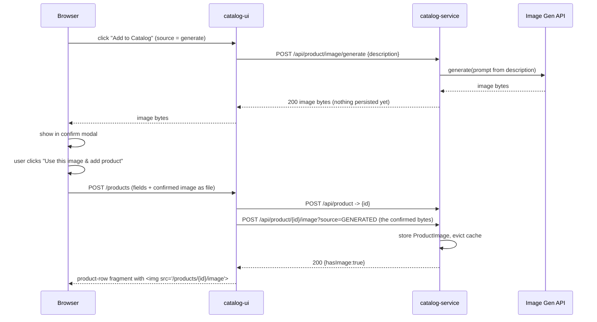
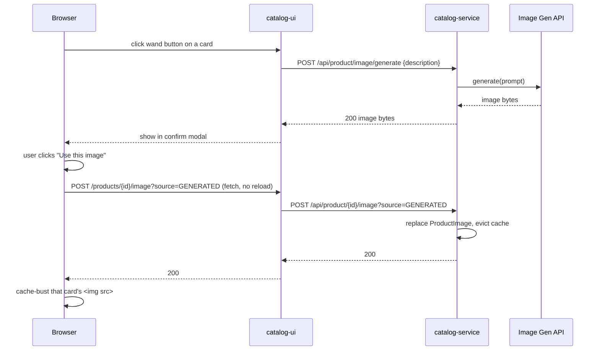

# Spec: Product Images (Upload + AI-Generated)

| | |
|---|---|
| **Status** | Draft — for review |
| **Author** | Claude Code (drafted with shravan.mali@gmail.com) |
| **Date** | 2026-10-11 |
| **Services touched** | `catalog-service`, `catalog-ui` |

## 1. Problem / Goal

Products in the catalog currently have no visual representation — the
product card (`fragments/product-row.html`) shows only name, description,
price, and quantity. We want to let a user add an image to a new product
in one of two ways:

1. **Upload** an image file directly in the "New Product" form.
2. **Generate** an image automatically from the product's `description`
   text, via an AI image-generation API, with one click.

Either path should end with the product having a displayable image, shown
on the catalog card and the image persisted so it survives restarts.

## 2. User stories

- As a user filling out the "New Product" form, I can attach a photo of
  the product before submitting, and see it on the resulting catalog card.
- As a user who doesn't have a photo, I can click **"Generate image"**
  after typing a description, see a preview, and either accept it or
  regenerate, before submitting the product.
- As a user browsing the catalog, I see each product's image (or a
  neutral placeholder if none was ever set) on its card.

## 3. Scope

**In scope**
- Single image per product (no galleries).
- Manual upload (JPEG/PNG/WebP) on product creation, with the user
  confirming the exact image before the product is saved (v1.1, §5.6).
- AI-generated image from `description`, on product creation **and**
  for an already-existing product (v1.1 - see below), both gated behind
  the same preview-and-confirm step before anything is persisted.
- Serving/display of the image on the catalog UI.

**Out of scope**
- ~~Editing/replacing the image of an existing product~~ - **v1.1
  narrows this**: *regenerating* an existing product's image via AI is
  now supported (the wand button on each card). Manually *uploading* a
  replacement photo for an existing product is still not wired into the
  UI, even though the backend endpoint would support it.
- Multiple images / image galleries.
- Content moderation pipeline beyond basic provider-side safety filters.
- Image CDN / external object storage (S3, etc.) — see §5.3 for why.

## 4. Current architecture (relevant parts)

- `catalog-service` owns `Product` (JPA entity, Postgres, `ddl-auto: update`
  so new nullable columns migrate automatically — no Flyway/Liquibase in
  this repo).
- `getProductById` is `@Cacheable(value = "product")`; `reduceQuantity`
  evicts that cache key. Any new field returned by `GET /api/product/{id}`
  must be in `ProductResponse` or the cached payload will be stale/incomplete.
- `catalog-ui` never calls `catalog-service` from the browser directly —
  all calls are server-side via `RestTemplate` + Eureka logical names
  (`http://CatalogService/...`), and the UI exposes its own proxy
  endpoints (e.g. `GET /products/lookup-upc/{code}` proxies to
  `catalog-service`'s `/api/product/lookup-upc/{code}`). The existing UPC
  autofill feature is the closest precedent for "call an external API,
  show a preview, let the user accept it before submit" — the image
  features follow the same shape.
- No object storage, no static-file volume shared between containers.

## 5. Design

### 5.1 Data model

Add one nullable column to `Product`:

```java
@Column(length = 2000)
private String imageUrl;   // nullable; path the browser can request, e.g. "/api/product/42/image"
```

We do **not** store image bytes in a new BLOB-mapped entity field read
eagerly with the product row — see §5.3 for the actual byte storage
design. `imageUrl` here is really "does this product have an image" plus
the path to fetch it; it's populated by `catalog-service` itself after a
successful upload/generate, not supplied by the client.

`ProductRequest` / `ProductResponse` gain:

```java
// ProductResponse
private boolean hasImage;   // derived, not a DB column — true if image bytes exist
```

(We expose `hasImage` rather than a full URL in the JSON so `catalog-ui`
builds the URL itself, consistent with how it already builds its own
proxy routes.)

### 5.2 New entity: `ProductImage`

```java
@Entity
@Table(name = "product_image")
public class ProductImage {
    @Id
    private long productId;        // shared PK / FK to Product.id, one-to-one

    @Lob
    @Column(columnDefinition = "bytea")
    private byte[] data;

    private String contentType;    // "image/jpeg", "image/png", "image/webp"
    private String source;         // "UPLOAD" | "GENERATED"
    private Instant createdAt;
}
```

Keeping image bytes in a **separate table**, not a column on `Product`,
matters because `getAllProducts()` and `getProductById()` already return
lightweight `ProductResponse` objects and are cached in Redis — we don't
want multi-hundred-KB blobs riding along on every catalog list fetch or
sitting in the Redis cache. The image is fetched by its own endpoint,
on demand, only when the `` tag actually requests it.

### 5.3 Storage decision: Postgres `bytea`, not a file volume or S3

Options considered:

| Option | Verdict |
|---|---|
| Shared filesystem volume between `catalog-service` and `catalog-ui` containers | Rejected — adds a new docker-compose volume just for this, and `catalog-ui` would need direct filesystem access, breaking the "everything crosses service boundaries over HTTP/Eureka" pattern the rest of the app follows. |
| S3 / object storage | Rejected for v1 — real infra dependency, new credentials, overkill for a demo app with no deployment target configured for it yet. Worth revisiting if this goes to a real cloud deployment. |
| **Postgres `bytea` in a dedicated table, streamed via an endpoint** | **Chosen.** No new infra — Postgres is already a dependency. Keeps the microservice boundary intact: the image is just another resource `catalog-service` owns and serves over HTTP, exactly like every other piece of product data. |

### 5.4 API: `catalog-service`

| Method | Path | Purpose |
|---|---|---|
| `POST` | `/api/product` | *(existing, unchanged)* creates the product row, no image yet |
| `POST` | `/api/product/{id}/image?source=UPLOAD\|GENERATED` | Upload/attach: `multipart/form-data`, field `file`. Validates type/size (§7), stores as `ProductImage`, sets `hasImage=true`. `source` (added in v1.1, default `UPLOAD`) just records provenance - see §5.6. |
| `POST` | `/api/product/{id}/image/generate` | Generate-and-persist directly against a product (uses its stored `description`). Still used as a fallback if the client-side confirm flow (§5.6) can't run for some reason; the UI itself no longer calls this on the happy path. |
| `POST` | `/api/product/image/generate` *(v1.1)* | **Stateless preview**: body `{"description": "..."}`, returns image bytes directly - no product id, no persistence. This is what makes the confirm-before-save flow in §5.6 possible. |
| `GET` | `/api/product/{id}/image` | Streams the bytes with the stored `Content-Type`. `404` if no image. `Cache-Control: max-age=3600` since an image, once set, isn't expected to change out from under that cached response - a replacement (§5.6) is served from a different byte sequence, and the UI cache-busts the URL when it knows one just happened. |

The two image-write endpoints evict the `product` Redis cache key for
that id (same pattern `reduceQuantity` already uses), since `hasImage`
on `ProductResponse` changes. The stateless preview endpoint touches no
database row and therefore nothing to evict.

### 5.5 AI image generation

New interface so the provider is swappable, mirroring how
`upc-lookup.url` is externalized today:

```java
public interface ImageGenerationClient {
    byte[] generate(String prompt); // returns PNG/JPEG bytes, throws ImageGenerationException
}
```

**Provider (v1, decided): Pollinations.ai** (`image.pollinations.ai/prompt/{prompt}`)
— a free, unauthenticated text-to-image API: a single `GET` request
returns image bytes directly, no API key, account, or billing required.
(§9 originally left this open with OpenAI as the default recommendation;
revisited and switched to Pollinations.ai specifically so this feature
needs no secret to work out of the box — reasonable for a demo app. Any
provider works behind the `ImageGenerationClient` interface above;
swapping to a paid provider for better/more controllable output later is
a config + one new class, not a redesign.)

- **Config** (new, externalized like `upc-lookup.url`):
  ```yaml
  image-generation:
    base-url: https://image.pollinations.ai/prompt
  ```
  No secret, so no env var/`.env` plumbing is needed for this provider.
  `isConfigured()` on `ImageGenerationClient` always returns `true` for
  it; the method still exists on the interface for a future provider that
  *does* need a key, in which case the generate endpoint returns `503`
  with a clear error rather than failing confusingly deep in a
  `RestClientException`.
- **Prompt construction**: `"Product photo of: " + description`,
  truncated to a safe length. No user-supplied prompt field in v1 — the
  description is the only input, which also sidesteps needing a separate
  prompt-injection/moderation review for freeform prompts.
- **Timeout**: explicit `RestTemplate` timeout (20s connect / 60s read —
  Pollinations.ai is a free, best-effort service and can be slow under
  load) — image generation is slow, and the UI's synchronous "Generate"
  click needs a bound so it doesn't hang indefinitely.
- **Failure handling**: on timeout/error, the endpoint returns a
  structured error (`{"errorCode":"IMAGE_GENERATION_FAILED"}`, `502`);
  the UI shows a toast (reusing the existing `error-toast` fragment
  pattern) and the user can retry or fall back to uploading manually.
- **Cost control**: this is a demo app behind no auth — add a simple
  per-request guard (e.g. reject if `description` is blank) and note in
  §9 that there's no rate limiting; acceptable for local/demo use, called
  out explicitly as a gap if this is ever exposed publicly.

### 5.6 `catalog-ui` changes (revised in v1.1 - confirm-before-save)

v1 shipped with image generation happening silently, server-side, right
after product creation (the sequence diagram further down used to show
exactly that). v1.1 replaces it with an explicit **preview-and-confirm**
step, driven entirely client-side, before anything is persisted - the
Open Question from §9 ("regenerate-on-submit vs. reuse preview bytes")
is now resolved in favor of the latter: generate once, show it, let the
user accept or regenerate, and submit the *exact* confirmed bytes.

**Form** (`products.html`, "New Product" panel): the image-source radio
group (`none` / `upload` / `generate`) is unchanged, but neither path
attaches anything automatically on submit anymore:

- `upload`: file input + live `FileReader` preview, same as v1.
- `generate`: no in-form preview button - clicking the form's own **"Add
  to Catalog"** button is what triggers generation now (see below).
- The submit button is a plain `type="button"` (not `type="submit"`),
  and the `<form>` only reacts to a custom `confirmed-submit` event
  (`hx-trigger="confirmed-submit"`, with `onsubmit="return false"` as a
  belt-and-suspenders block on the browser's native Enter-to-submit).
  `handleAddToCatalogClick()` in `product-image.js` is the real entry
  point: it runs `form.reportValidity()` first (so required-field
  validation still works without a native submit button), then branches
  on the selected image source.

**The confirmation modal** (`#image-confirm-modal`, new markup styled
like the existing scanner modal) is shared by two call sites:

1. **New product, source = upload**: shows the already-selected file's
   preview immediately (no network call) with Confirm/Cancel (no
   Regenerate - there's nothing to regenerate for a manually chosen file).
2. **New product, source = generate**: calls the stateless
   `POST /products/image/generate-preview` proxy (§5.4) with the
   description, shows a spinner, then the result, with
   Confirm/Regenerate/Cancel. Confirm is disabled until there's an
   actual image to confirm (including after a failed generation - the
   button doesn't silently re-enable with nothing behind it).
3. **Existing product, "Generate/Regenerate Image" button** on each
   catalog card (new in v1.1, see below) reuses the identical modal.

On **Confirm**:
- *create-upload*: the file is already sitting in the form's hidden
  `#imageFile` input - just dispatch `confirmed-submit`.
- *create-generate*: the previewed blob is wrapped as a `File` and
  injected into that same `#imageFile` input via the `DataTransfer` API,
  then `confirmed-submit` is dispatched. Either way,
  `ProductUiController.addProduct` now does one thing with images,
  not two: if a file is present, forward it to
  `POST /api/product/{id}/image?source=UPLOAD|GENERATED` (source tagged
  from which radio was selected, for provenance only - see §5.2). The
  old "call `/image/generate` directly after creation" branch is kept
  only as a defensive fallback for the (should-be-rare) case where
  `generate` was selected but no confirmed file made it into the
  request.
- *existing-generate* (regenerating an existing product's image): the
  browser itself calls `POST /products/{id}/image?source=GENERATED`
  directly (no page reload) via `fetch`, then cache-busts that card's
  `` (`?t=<timestamp>`) to show the new image immediately.

**Existing products** (new in v1.1): every catalog card gets a small
wand-icon button overlaid on its image (`product-row.html`), labeled via
its `title` attribute ("Generate Image" / "Regenerate Image" depending
on `hasImage`). It carries the product's id/name/description as `data-*`
attributes (Thymeleaf-escaped) and calls `regenerateProductImage(this)`,
which opens the same confirmation modal pre-loaded with a preview
generated from that product's existing description. This directly
supersedes the "editing an existing product's image is out of scope"
line from §3/§9 - regenerating is now supported; manually *uploading* a
replacement for an existing product is not yet wired into the UI (the
backend endpoint supports it - §5.4 - just nothing calls it that way).

**Product card** (`fragments/product-row.html`): the `` (with
`id="product-image-{id}"` for the regenerate button's cache-busting, and
the same placeholder-on-error fallback as v1) now sits inside a
`position: relative` wrapper alongside the generate/regenerate button.

New/changed UI proxy endpoints on `ProductUiController`:
- `POST /products/{id}/image` *(now public, not just an internal helper)* - upload/attach passthrough, used by both the create flow and the existing-product regenerate flow.
- `POST /products/image/generate-preview` *(v1.1)* - stateless passthrough to the new preview endpoint; returns image bytes or a JSON error body (502/503/400 relayed from `catalog-service`).
- `GET /products/{id}/image` - unchanged, stream passthrough.
- `POST /products/{id}/image/generate` - unchanged, kept only as the server-side fallback described above.

## 6. Sequences

**New product, generate-from-description (confirm-first, v1.1):**



**Existing product, "Regenerate Image" button (v1.1):**



## 7. Non-functional requirements

- **File validation (upload)**: content-type whitelist (`image/png`,
  `image/jpeg`, `image/webp`), max size **5 MB**, rejected with `400` +
  structured error, reusing the `ProductServiceException` pattern
  (`errorCode: "INVALID_IMAGE"`).
- **Multipart config**: Spring Boot default max multipart size (1 MB) is
  too small — raise `spring.servlet.multipart.max-file-size` /
  `max-request-size` to `5MB` in both `catalog-service` and `catalog-ui`.
- **Timeouts**: as noted in §5.5, bound the AI call explicitly.
- **Rate limits (Pollinations.ai)**: the anonymous tier is documented at
  one request every 15s; a burst of generate/regenerate calls (manual
  testing, or a user mashing "Regenerate") returns `402 Payment
  Required` from the provider, surfaced to the user as a normal
  `IMAGE_GENERATION_FAILED` error with a Regenerate option - confirmed
  working as intended during testing, not a bug. Registering a free
  token at `auth.pollinations.ai` raises this to one request every 5s
  (and removes the watermark - §5.5); worth doing if this limit is hit
  in normal use.
- **Security**: no new attack surface beyond standard file-upload
  hygiene (type/size validation, never trust the client-supplied
  `Content-Type` header alone — sniff magic bytes server-side too). API
  key stays server-side only, never sent to the browser.
- **Backward compatibility**: existing products (no `ProductImage` row)
  simply get `hasImage=false` / `404` on the image endpoint → UI falls
  back to the placeholder. No backfill needed.

## 8. Testing plan

- Unit: `ProductServiceImpl` — image upload validation (type/size
  rejection), cache eviction on image write, `ImageGenerationClient`
  failure → `502` mapping.
- Integration: upload round-trip (`POST` then `GET` the same bytes
  back); generate round-trip with a mocked `ImageGenerationClient`.
- Manual/E2E (via the `run` skill once implemented): create a product
  with an uploaded image, create one with a generated image, confirm
  both render on the catalog card and survive a `docker compose restart`.

## 9. Open questions

1. ~~**Re-generate vs. reuse preview bytes**~~ — **Resolved in v1.1**:
   reuse the confirmed preview bytes (§5.6) - the user explicitly asked
   for a confirmation step before the product is saved, which only makes
   sense if the bytes they confirmed are the bytes that get persisted.
   One AI call per generate/regenerate click, not two.
2. ~~**Which AI provider**~~ — **Resolved**: Pollinations.ai (§5.5), a
   free unauthenticated API, specifically so the feature needs no API key
   to work. Revisit if its output quality/reliability isn't good enough
   — the `ImageGenerationClient` interface makes swapping providers a
   small, contained change.
3. ~~**Editing an existing product's image**~~ — **Narrowed in v1.1**:
   AI regeneration for an existing product is now supported (§5.6);
   manual upload-replace for an existing product is still not in the UI
   (open: worth adding if users want to upload a photo for a product
   that only ever got an AI-generated or placeholder image).

## 10. Rollout plan

1. **Phase 1 — Upload only**: `ProductImage` entity, upload/fetch
   endpoints, UI form + card changes, placeholder fallback. Ships value
   independently and de-risks the storage/serving design before adding
   the AI dependency.
2. **Phase 2 — AI generation**: `ImageGenerationClient`, generate
   endpoint, UI "Generate" button + preview. Additive — Phase 1 continues
   to work unchanged.
